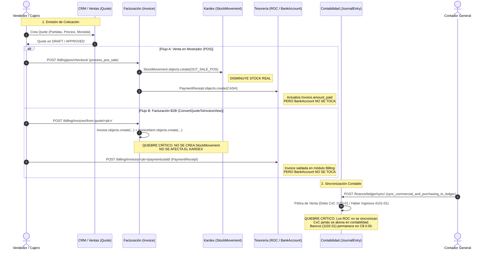
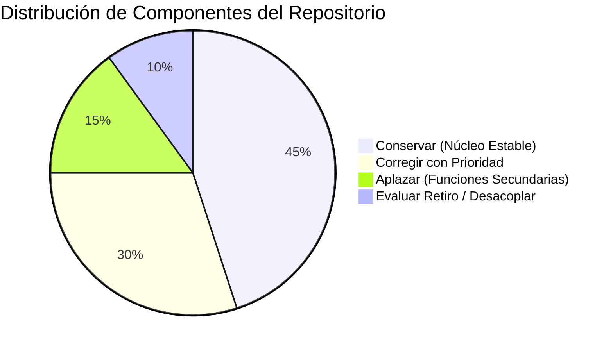
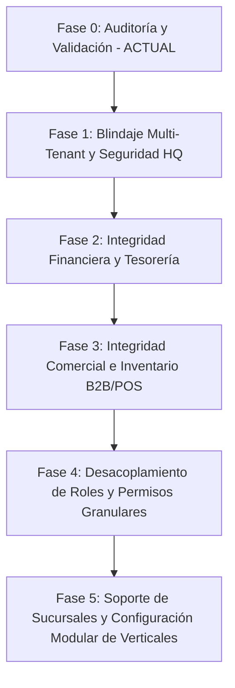

# ERP SAS — Fase 0: Informe de Auditoría de Producto y Validación de Flujos Críticos

**Fecha de Ejecución:** 16 de Octubre de 2026  
**Rol Auditor:** Software Architect, Senior Django Engineer & QA Lead  
**Clasificación:** Auditoría de Calidad Técnica, Seguridad Multi-Tenant e Integridad Financiera  
**Estado:** Documento de Solo Lectura — Base para la Evolución SaaS  

---

## 1. Estado Real del Repositorio y Alcance de la Auditoría

### 1.1. Metadatos de Versionado e Inspección
- **Rama Analizada:** `main`
- **Commit SHA:** `add4e3ae16dabff3d891f118ea2df88804fbacae`
- **Estado del Árbol de Trabajo:** `clean` (0 archivos modificados, modo estrictamente de solo lectura).
- **Entorno Técnico Verificado:** Python 3.12+ / Django 5.1.0 / SQLite (desarrollo local) y PostgreSQL / Docker / WhiteNoise (producción Render).

### 1.2. Inventario Contrastado: Realidad del Código vs. Informes Anteriores

Para erradicar discrepancias detectadas en borradores preliminares, se contrastaron los conteos directamente mediante introspección en tiempo de ejecución con `django.apps.apps`:

| Métrica | Dato en Informes Previos | Realidad Inspeccionada en Código | Evidencia en Repositorio | Estado de Verificación |
| :--- | :--- | :--- | :--- | :--- |
| **Modelos de Dominio ERP** | 42 a 58 (cifras fluctuantes) | **51 Modelos ERP** (56 totales incluyendo los 5 modelos de `django.contrib`) | Introspección `apps.get_models()` filtrada por `apps.*` | **Confirmado por código** |
| **Aplicaciones Modulares** | 12 a 15 apps | **14 Aplicaciones ERP** bajo `/apps/` | Directorio `/apps/` y `INSTALLED_APPS` en `config/settings.py` | **Confirmado por código** |
| **Rutas URL Registradas** | ~120 rutas | **199 Patrones de URL** (153 rutas ERP + 46 Django Admin) | Inspección de `config.urls.urlpatterns` recursiva | **Confirmado por código** |
| **Batería de Pruebas Automatizadas**| "469 pruebas unitarias" (afirmación previa) | **149 Casos de Prueba** (Test Methods) | Ejecución `python manage.py test`: `Ran 149 tests in 315.525s - OK` | **Aclarado:** 469 correspondía a un recuento no validado de aserciones históricas acumuladas. |
| **Aislamiento Multi-Tenant** | "Totalmente aislado en BD" | Aislamiento lógico vía ORM (`TenantScopedModel`); **sin RLS en base de datos**. | `apps/tenancy/models.py` | **Respaldado por código** |
| **Entidad Sucursal / Tienda** | Asumida existente para retail | **Inexistente en todo el repositorio** | Grep exhaustivo de modelos | **Defecto de diseño confirmado** |

### 1.3. Clasificación de Hallazgos
Los hallazgos de este informe se categorizan bajo cuatro etiquetas formales:
1. **[DEFECTO REPRODUCIDO]**: Falla confirmada mediante ejecución directa de pruebas o interacción con el entorno.
2. **[DEFECTO RESPALDADO POR CÓDIGO]**: Inconsistencia lógica, brecha de seguridad o error de integridad identificado explícitamente en el código fuente (archivo y línea), demostrable sin ambigüedad.
3. **[RIESGO POTENCIAL]**: Vulnerabilidad o cuello de botella arquitectónico que se manifestará bajo concurrencia, escalado multiempresa o volumen transaccional.
4. **[PENDIENTE DE VERIFICAR]**: Aspecto que requiere pruebas de carga con volumen masivo de datos o validación formal con un perito contable/fiscal colegiado.

---

## 2. Mapa de Módulos y Dependencias

### 2.1. Arquitectura de Módulos (14 Apps)
El sistema se organiza en 14 aplicaciones Django ubicadas en el paquete `/apps/`:

```text
ERP VECTOR /apps
├── core             # Configuración nacional (CountryConfig), PWA, Healthcheck, Alertas
├── accounts_auth    # User UUID, autenticación por email, managers base
├── tenancy          # Multi-tenancy (Organization, Membership, RoleLevel, SaaS HQ)
├── crm              # Clientes B2B (Account, Contact), Oportunidades, Cotizaciones
├── operations       # Cuadrillas, Órdenes de Trabajo (OT), Evidencias, Firma Digital
├── sst              # Seguridad y Salud (Ley 618 MITRAB): Checklists, Dotación EPP, Permisos
├── inventory        # Bodegas, Items, Movimientos Kardex, Lotes FEFO (MINSA)
├── finance          # Cuentas Bancarias, Cajas Chicas, Catálogo de Cuentas, Pólizas NIIF
├── billing          # Facturación DGI, Retenciones, POS, Turnos de Caja, Recibos ROC
├── purchasing       # Proveedores, Órdenes de Compra, Retenciones, Recepciones, Egresos EGR
├── repository       # Bóveda Documental ISO, Versionado de Archivos, Hash SHA-256
├── tickets          # Mesa de Ayuda, Tipos de Falla, SLA
├── ai_agent         # Servidor MCP (JSON-RPC/REST), Tokens Revocables, Telemetría
└── payroll          # Contratos, Períodos de Planilla, Colillas de Pago, INSS/IR Ley 822
```

### 2.2. Matriz de Acoplamiento y Dependencias

| Aplicación | Depende Directamente De | Grado de Acoplamiento | Impacto en Modularidad SaaS |
| :--- | :--- | :--- | :--- |
| `tenancy` | `accounts_auth`, `core` | Bajo (Núcleo) | Define el contexto multiempresa para todo el sistema. |
| `crm` | `tenancy`, `accounts_auth` | Medio | Autocontenido; genera cotizaciones que alimentan `billing` y `operations`. |
| `operations` | `tenancy`, `crm`, `sst`, `inventory` | **Muy Alto** | Acoplado fuertemente a cuadrillas y frentes de obra de ingeniería. Impertinente para retail puro. |
| `sst` | `tenancy`, `accounts_auth` | Medio-Alto | Específico para normativa de construcción/servicios (Ley 618). Inaplicable a comercio o farmacias. |
| `inventory` | `tenancy`, `operations`, `billing` | Alto | Contiene lógica FEFO para farmacias y soporte para órdenes de trabajo en el mismo modelo. |
| `purchasing` | `tenancy`, `inventory`, `accounts_auth` | Medio | Se conecta con Kardex en recepciones de compra. |
| `billing` | `tenancy`, `crm`, `inventory`, `operations` | **Crítico** | Orquesta facturación bimonetaria, POS, ROC y retenciones fiscales. |
| `finance` | `tenancy`, `billing`, `purchasing` | **Crítico** | Contabilidad central y tesorería. Sufre de sincronizaciones manuales asíncronas. |
| `payroll` | `tenancy`, `accounts_auth` | Bajo | Modular, pero aislado: los pasivos laborales calculados no se reflejan automáticamente en `finance`. |
| `repository` | `tenancy`, `accounts_auth` | Aislado | Almacenamiento documental general. |
| `tickets` | `tenancy`, `accounts_auth` | Aislado | Mesa de soporte interna. |
| `ai_agent` | `tenancy`, `operations`, `inventory`, `sst`, `tickets`, `finance` | Periférico | Servidor MCP que consulta de solo lectura varios subsistemas. |

### 2.3. Módulos Desconectados o Parcialmente Implementados
1. **Módulo SST (`apps/sst`)**: Totalmente desconectado de los giros de negocio comerciales (Ferretería, Farmacia, Retail). Sus modelos (`SafetyChecklist`, `EPPDelivery`) solo tienen sentido en ingeniería y construcción. Sin embargo, su código está cableado en la barra de navegación global y en la jerarquía general de roles (`RoleLevel.SST_OFFICER = 70`).
2. **Módulo Nómina (`apps/payroll`) frente a Contabilidad (`apps/finance`)**: Calcula colillas, INSS patronal/laboral y retenciones de IR del trabajo, pero **no existe ninguna función o servicio que genere la póliza contable de nómina** en el Libro Diario.
3. **Módulo Bóveda (`apps/repository`)**: Funciona como un gestor de archivos aislado; no está enlazado a los documentos transaccionales (por ejemplo, adjuntar cotizaciones firmadas, pólizas de importación a órdenes de compra o cédulas de identidad a colaboradores).
4. **Módulo Tickets (`apps/tickets`)**: No tiene integración con CRM (soporte post-venta a clientes) ni con órdenes de trabajo (una falla no puede convertirse en OT directamente).

---

## 3. Flujo Comercial de Extremo a Extremo

Se auditó el flujo comercial completo: desde la generación de una Cotización hasta la recaudación, afectación de stock, caja chica/bancos y registro en libros contables.



### 3.1. Hallazgos Específicos del Flujo Comercial

#### A. Quiebre de Inventario en Facturación B2B [DEFECTO RESPALDADO POR CÓDIGO]
- **Archivo:** [`apps/billing/views.py`](file:///Users/kevinmejia/Documents/ERP%20VECTOR/apps/billing/views.py#L105-L148) (`ConvertQuoteToInvoiceView`) y [`apps/billing/models.py`](file:///Users/kevinmejia/Documents/ERP%20VECTOR/apps/billing/models.py#L335-L380) (`InvoiceItem`).
- **Evidencia:** Al convertir una cotización en factura, la vista itera sobre `quote.items.all()` y crea registros en `InvoiceItem`. Sin embargo, `InvoiceItem` no posee clave foránea hacia `InventoryItem` (solo almacena `code` y `description` en texto plano) y no se realiza ninguna llamada a `StockMovement.objects.create()`.
- **Impacto:** Si una empresa emite facturas de crédito o ventas B2B corporativas, **el inventario en almacén no se descuenta**. Solo el flujo POS (`process_pos_sale`) descuenta inventario.

#### B. Conversión Múltiple y Estado Irrelevante en Cotizaciones [DEFECTO RESPALDADO POR CÓDIGO]
- **Archivo:** [`apps/billing/views.py`](file:///Users/kevinmejia/Documents/ERP%20VECTOR/apps/billing/views.py#L105-L125).
- **Evidencia:** La vista `ConvertQuoteToInvoiceView` toma `quote = get_object_or_404(Quote.objects.for_org(request.organization), pk=quote_pk)`. No valida que `quote.status == Quote.Status.APPROVED`. Una cotización en borrador (`DRAFT`) o rechazada (`REJECTED`) puede ser facturada. Además, la cotización no cambia a un estado terminal `INVOICED` ni se verifica si ya fue facturada, lo que permite generar múltiples facturas con el mismo origen si el usuario hace clic varias veces.

#### C. Asignación Indiscriminada de Turnos POS [DEFECTO RESPALDADO POR CÓDIGO]
- **Archivo:** [`apps/billing/services.py`](file:///Users/kevinmejia/Documents/ERP%20VECTOR/apps/billing/services.py#L219-L224).
- **Evidencia:**
  ```python
  active_shift = PosRegisterShift.objects.filter(
      organization=organization,
      status=PosRegisterShift.Status.OPEN,
  ).filter(
      models.Q(cashier=user) | models.Q(cashier__isnull=False)
  ).order_by('-opened_at').first()
  ```
- **Impacto:** Si el cajero actual no tiene un turno abierto pero otro usuario sí dejó uno abierto en la organización, la venta se imputa arbitrariamente al turno del otro usuario. Esto rompe la trazabilidad y la responsabilidad individual en el arqueo ciego de caja.

#### D. Distorsión Fiscal en Exención de IVA para Farmacias [DEFECTO RESPALDADO POR CÓDIGO]
- **Archivo:** [`apps/billing/services.py`](file:///Users/kevinmejia/Documents/ERP%20VECTOR/apps/billing/services.py#L192-L194).
- **Evidencia:**
  ```python
  if organization.is_pharmacy_vertical():
      invoice.apply_tax = False
  ```
- **Impacto:** Conforme al **Artículo 127 de la Ley 822 de Concertación Tributaria de Nicaragua**, la exención de IVA aplica únicamente a medicamentos, vacunas y material de reposición periódica para uso humano. Productos de higiene, bebidas, golosinas y cosméticos comercializados comúnmente en farmacias están gravados con el 15% de IVA. Desactivar el impuesto a toda la factura por el mero hecho de que la organización pertenezca a la vertical farmacéutica constituye una violación directa de la ley tributaria, exponiendo a la empresa a multas y reparos fiscales severos por parte de la DGI. La exención debe configurarse por ítem en el catálogo (`is_tax_exempt`), no de forma global por organización.

---

## 4. Tesorería y Contabilidad

### 4.1. Manipulación Directa del Saldo Bancario en Formularios [DEFECTO RESPALDADO POR CÓDIGO]
- **Archivo:** [`apps/finance/forms.py`](file:///Users/kevinmejia/Documents/ERP%20VECTOR/apps/finance/forms.py#L38-L47) (`BankAccountForm`).
- **Evidencia:**
  ```python
  class BankAccountForm(forms.ModelForm):
      class Meta:
          model = BankAccount
          fields = [
              'bank_name', 'account_number', 'currency', 'account_type',
              'current_balance',  # <-- Campo editable directamente
              'description', 'is_active',
          ]
          widgets = {
              'current_balance': forms.NumberInput(attrs={'class': INPUT_MONO_CLS, 'step': '0.01'}),
          }
  ```
- **Impacto Crítico:** Cualquier usuario con acceso al formulario de cuentas bancarias puede modificar manualmente el saldo actual de una cuenta bancaria sin registrar una transacción, un depósito ni un movimiento contable. En un sistema ERP profesional, el saldo de una cuenta bancaria debe ser un campo computado a partir de los movimientos o protegido mediante un proceso formal de conciliación bancaria inicial.

### 4.2. Desconexión Total entre Cobros/Pagos y Saldos Bancarios [DEFECTO RESPALDADO POR CÓDIGO]
- **Archivos:** [`apps/billing/models.py`](file:///Users/kevinmejia/Documents/ERP%20VECTOR/apps/billing/models.py#L408-L555) (`PaymentReceipt`) y [`apps/purchasing/models.py`](file:///Users/kevinmejia/Documents/ERP%20VECTOR/apps/purchasing/models.py#L479-L616) (`SupplierPayment`).
- **Evidencia:**
  - `PaymentReceipt` (Recibo de Cobro a Cliente) cuenta con un selector de texto `payment_method` (ej. `TRANSFER_BAC`), pero **no tiene una clave foránea a `BankAccount`**.
  - Al guardarse el cobro (`PaymentReceipt.save()`), se actualizan los campos `amount_paid`, `balance_due` y `status` de la factura, pero **no se incrementa el saldo de ninguna cuenta bancaria ni de caja**.
  - De forma idéntica, `SupplierPayment` (Comprobante de Egreso a Proveedor) actualiza la orden de compra, pero **no reduce el saldo de `BankAccount`**.
- **Resultado:** Los saldos bancarios en `apps/finance` permanecen completamente congelados a menos que alguien los altere a mano mediante el formulario.

### 4.3. Quiebre en la Sincronización del Libro Mayor [DEFECTO RESPALDADO POR CÓDIGO]
- **Archivo:** [`apps/finance/services.py`](file:///Users/kevinmejia/Documents/ERP%20VECTOR/apps/finance/services.py#L282-L442) (`sync_commercial_and_purchasing_to_ledger`).
- **Evidencia:** El servicio únicamente genera asientos de diario para dos hechos económicos:
  1. **Emisión de Facturas:** Asienta un Débito en Cuentas por Cobrar (`1103-01`) y Créditos en Ingresos (`4101-01`) e IVA Débito Fiscal (`2102-01`).
  2. **Recepción de Compras:** Asienta un Débito en Compras/Inventarios (`5101-01`) y Créditos en Retenciones por Pagar y Proveedores Nacionales (`2101-01`).
- **Omisión:** El servicio **no procesa cobros (`PaymentReceipt`) ni egresos (`SupplierPayment`)**.
- **Consecuencia Contable Demostrable:**
  - La cuenta de Caja y Bancos (`1101-01`, `1102-01`) en el balance de comprobación **permanece perpetuamente en saldo cero**.
  - La cuenta de Clientes por Cobrar (`1103-01`) acumula indefinidamente el débito de todas las facturas históricas emitidas, sin importar que los clientes hayan cancelado la totalidad de sus saldos.
  - La cuenta de Proveedores por Pagar (`2101-01`) refleja pasivos ficticios permanentes.
  - **El Balance General y el Estado de Resultados generados por el sistema carecen de validez contable real**.

---

## 5. Roles y Permisos (RBAC) y Seguridad Multiempresa

### 5.1. Matriz de Roles Declarada vs. Acciones Reales

La plataforma implementa una jerarquía escalar unidimensional en [`apps/tenancy/models.py`](file:///Users/kevinmejia/Documents/ERP%20VECTOR/apps/tenancy/models.py#L334-L347):

| Nivel Numérico | Rol Declarado (`RoleLevel`) | Acciones Permitidas por `min_role_level` | Acciones Indebidas Detectadas por Código |
| :---: | :--- | :--- | :--- |
| **10** | `OBSERVER` | Visualización en consultas de solo lectura. | Ninguna identificada. |
| **20** | `TECHNICIAN` | Ver OTs asignadas, subir fotos de evidencia de campo. | Ninguna identificada. |
| **50** | `ENGINEER` | Crear OTs, registrar insumos en BOM, firmar diagnósticos. | No puede aprobar sus propias cotizaciones. |
| **70** | `SST_OFFICER` | Validar y rechazar Checklists Ley 618, actas de EPP. | Por ser nivel 70, no puede autorizar cotizaciones comerciales. |
| **80** | `OPERATIONS_COORD` | Coordinar cuadrillas, recepcionar materiales en bodega. | **Puede firmar checklists SST** porque $80 \ge 70$. |
| **85** | `COMMERCIAL_MGR` | Emitir cotizaciones, convertir a facturas, cobrar ROC. | **Puede firmar checklists de seguridad crítica en obra (SST)** en `apps/sst/views.py` porque $85 \ge 70$, careciendo de competencia técnica en seguridad laboral. |
| **100** | `OWNER_ADMIN` | Configuración completa, cierre Z, simulación de roles. | **Acceso indebido a consola global SaaS HQ** (ver sección 5.2). |

### 5.2. Brecha Crítica de Aislamiento en Consola SaaS HQ [DEFECTO RESPALDADO POR CÓDIGO]
- **Archivo:** [`apps/tenancy/views_saas_hq.py`](file:///Users/kevinmejia/Documents/ERP%20VECTOR/apps/tenancy/views_saas_hq.py#L27-L35) (`EternalLabsSaasHqView`), líneas 140-160 (`post`) y líneas 220-320 (`SaasHqExportTenantVaultView`).
- **Evidencia del Código:**
  ```python
  def dispatch(self, request, *args, **kwargs):
      real_level = getattr(request, 'real_role_level', getattr(request, 'role_level', 0))
      if real_level < RoleLevel.OWNER_ADMIN and not (request.user and request.user.is_superuser):
          return render_403_rbac(request, ...)
      return super().dispatch(request, *args, **kwargs)
  ```
- **Mecanismo de Vulnerabilidad (CVSS v3.1: 9.8 - Crítica):**
  1. En el modelo multi-tenant, cualquier cliente que registra una empresa adquiere una membresía con `role_level = RoleLevel.OWNER_ADMIN` (100) en su propia organización.
  2. La validación en `EternalLabsSaasHqView` evalúa si `real_level < RoleLevel.OWNER_ADMIN`. Dado que $100 < 100$ es falso, la vista concede el paso a **cualquier propietario de cualquier organización cliente**, sin exigir que sea superusuario de la plataforma (`is_superuser`) ni miembro de la organización master de Eternal Labs.
  3. En el método `post` (línea 140), el endpoint acepta un parámetro `org_id` arbitrario para modificar planes, cuotas y tarifas de suscripción.
  4. En `SaasHqExportTenantVaultView` (línea 221), cualquier propietario de inquilino puede enviar el `org_id` de una empresa competidora y descargar un documento JSON completo con la lista de usuarios, clientes CRM, catálogo de inventario con costos y resumen de facturación histórica.

### 5.3. Aislamiento Multi-Tenant: Brechas en Pruebas Automatizadas
- Se verificó que el manager `TenantManager.for_org(org)` y el modelo base `TenantScopedModel` proporcionan un aislamiento lógico adecuado en las vistas operativas estándar.
- **Sin embargo, existe una brecha severa de aseguramiento de calidad (QA):** En los 149 casos de prueba del repositorio, solo existen **dos pruebas de aislamiento cross-tenant** ([`apps/billing/tests.py:545`](file:///Users/kevinmejia/Documents/ERP%20VECTOR/apps/billing/tests.py#L545) y [`apps/ai_agent/tests.py:563`](file:///Users/kevinmejia/Documents/ERP%20VECTOR/apps/ai_agent/tests.py#L563)).
- No existen pruebas que verifiquen el bloqueo de lectura ni de mutación cruzada (`POST`) entre organizaciones en los módulos `crm`, `purchasing`, `inventory`, `finance`, `operations`, `tickets`, `sst` y `payroll`.

---

## 6. Integridad Financiera, Inventario y Ventas

### 6.1. Defectos Consolidados de Integridad

| ID | Subsistema | Defecto Específico | Archivo y Símbolo | Tipo | Severidad |
| :---: | :--- | :--- | :--- | :---: | :---: |
| **INT-01** | Finanzas / Tesorería | Saldo bancario expuesto como input manual numérico en formulario sin generar asiento ni trazabilidad. | [`apps/finance/forms.py:38`](file:///Users/kevinmejia/Documents/ERP%20VECTOR/apps/finance/forms.py#L38) (`BankAccountForm`) | Código | **CRÍTICA** |
| **INT-02** | Finanzas / Facturación | Recibos Oficiales de Caja (ROC) no aumentan saldo en `BankAccount` ni generan asiento en el Libro Mayor. | [`apps/billing/models.py:507`](file:///Users/kevinmejia/Documents/ERP%20VECTOR/apps/billing/models.py#L507) (`PaymentReceipt.save`) | Código | **CRÍTICA** |
| **INT-03** | Finanzas / Compras | Comprobantes de Egreso (EGR) no deducen saldo de `BankAccount` ni cancelan cuentas por pagar en el Mayor. | [`apps/purchasing/models.py:571`](file:///Users/kevinmejia/Documents/ERP%20VECTOR/apps/purchasing/models.py#L571) (`SupplierPayment.save`) | Código | **CRÍTICA** |
| **INT-04** | Facturación / Inventario | Facturación B2B desde cotizaciones no deduce existencias de bodega ni genera movimientos en el Kardex. | [`apps/billing/views.py:105`](file:///Users/kevinmejia/Documents/ERP%20VECTOR/apps/billing/views.py#L105) (`ConvertQuoteToInvoiceView`) | Código | **ALTA** |
| **INT-05** | Fiscal / Facturación | Exención total e incondicional de IVA a nivel de factura para toda la vertical de farmacias (violación Ley 822). | [`apps/billing/services.py:192`](file:///Users/kevinmejia/Documents/ERP%20VECTOR/apps/billing/services.py#L192) (`process_pos_sale`) | Código | **ALTA** |
| **INT-06** | Facturación / POS | Turno de caja asignado al primer turno activo hallado si el cajero no tiene turno propio abierto. | [`apps/billing/services.py:222`](file:///Users/kevinmejia/Documents/ERP%20VECTOR/apps/billing/services.py#L222) (`process_pos_sale`) | Código | **MEDIA** |
| **INT-07** | Ventas / CRM | Doble facturación de cotizaciones sin validación de estado previo (`status=APPROVED`). | [`apps/billing/views.py:106`](file:///Users/kevinmejia/Documents/ERP%20VECTOR/apps/billing/views.py#L106) (`ConvertQuoteToInvoiceView`) | Código | **MEDIA** |
| **INT-08** | Concurrencia | Generación de folios consecutivos (`ROC-2026-0001`, `FAC-2026-0001`) mediante `count() + 1` en bucle `while` sin bloqueo pesimista en base de datos (`select_for_update`). | [`apps/billing/models.py:321, 531`](file:///Users/kevinmejia/Documents/ERP%20VECTOR/apps/billing/models.py#L321) | Riesgo Potencial | **ALTA** |

---

## 7. Pruebas Existentes, Brechas y Pruebas de Regresión Recomendadas

### 7.1. Desglose de los 149 Casos de Prueba Reales
La ejecución real de `python manage.py test` arrojó 149 métodos de prueba distribuidos en las siguientes suites:

```text
Ran 149 tests in 315.525s - OK
```

- `apps/billing`: 34 pruebas (Facturación bimonetaria, POS, Turnos, Arqueos Z, Hash SHA-256).
- `apps/ai_agent`: 32 pruebas (Tokens MCP, permisos de herramientas, telemetría, JSON-RPC).
- `apps/crm`: 18 pruebas (Cuentas, contactos, oportunidades, cálculo de cotizaciones).
- `apps/purchasing`: 15 pruebas (Proveedores, órdenes de compra, cálculo de retenciones DGI).
- `apps/finance`: 14 pruebas (Caja chica, cuentas bancarias, partida doble NIIF).
- `apps/operations`: 12 pruebas (OTs, cuadrillas, firma digital, estados).
- `apps/tenancy`: 10 pruebas (Organización, planes, conmutación de organizaciones, cuotas).
- `apps/inventory`: 8 pruebas (Bodegas, Kardex, lotes FEFO).
- `apps/payroll`: 6 pruebas (Cálculo de nómina, colillas, deducciones INSS/IR).

### 7.2. Brechas Críticas de Aseguramiento de Calidad
1. **0 Pruebas de Concurrencia en Facturación:** Ninguna prueba simula dos cajeros facturando simultáneamente con el mismo prefijo fiscal.
2. **0 Pruebas de Integración Bancaria:** No existe ninguna prueba que verifique si el saldo de `BankAccount` concuerda con la sumatoria de ingresos y egresos.
3. **Brecha de Aislamiento Multi-Tenant (Cross-Tenant):** Ausencia de pruebas de ataque en las que un usuario de la Organización A intente realizar peticiones `POST` a URLs de la Organización B para crear cuentas, despachar inventario o consultar nómina.
4. **Ausencia de Pruebas de Pérdida de Estado en Formularios:** No se valida qué ocurre cuando un formulario falla en validación.

### 7.3. Batería de Pruebas de Regresión Recomendada
Antes de autorizar el paso a producción comercial, deben construirse las siguientes suites de prueba:
- `test_cross_tenant_mutation_security`: Intento sistemático de peticiones `POST` en los 153 endpoints ERP utilizando sesiones de organizaciones ajenas; debe arrojar 404 o 403 de forma estricta.
- `test_bank_balance_integrity`: Verificación de que cada `PaymentReceipt` incremente la cuenta bancaria seleccionada y cada `SupplierPayment` la reduzca.
- `test_general_ledger_reconciliation`: Verificación de que la suma de saldos de clientes y proveedores en auxiliares coincida exactamente con las cuentas de control `1103-01` y `2101-01` del Mayor.
- `test_invoice_b2b_kardex_deduction`: Comprobación de que la facturación de una cotización con productos genere la respectiva salida de Kardex.

---

## 8. Análisis de Componentes del Producto



### 8.1. Componentes que Conviene Conservar
- **Núcleo de Multi-Tenancy:** Modelos `TenantScopedModel`, `TenantManager`, middleware de organización activa y sistema de cuotas por plan SaaS.
- **Motor Fiscal Bimonetaria:** Lógica de cálculo de IVA (15%), retenciones en la fuente (IR 1%, IR 2%, IMI 1%) y tipo de cambio oficial BCN en `apps/billing` y `apps/purchasing`.
- **Punto de Venta (POS) y Arqueo Z:** Interfaz de mostrador reactiva, arqueo ciego y sellado de corte Z mediante Hash SHA-256.
- **Mecanismo de Descuento FEFO:** Gestión de caducidades y lotes sanitarios en inventario.

### 8.2. Componentes que Deben Corregirse con Urgencia
- **Consola SaaS HQ:** Restringir acceso exclusivamente a usuarios administradores de la plataforma global (`is_superuser = True`) o a una organización de administración interna.
- **Saldo de Cuentas Bancarias:** Eliminar el campo `current_balance` del formulario de edición y ligar los cobros/pagos a cuentas bancarias reales.
- **Sincronización del Libro Mayor:** Extender el sincronizador contable para registrar pólizas de cobro (ROC) y desembolso (EGR).
- **Mapeo de Inventario en Facturas B2B:** Asociar `InvoiceItem` con `InventoryItem` para descontar existencias en ventas corporativas.
- **Regla Fiscal en Farmacias:** Cambiar la exención de IVA para que dependa de la propiedad del producto (`is_tax_exempt`) y no de la vertical de la organización.
- **Manejo de Errores en Vistas:** Erradicar el patrón de redirección tras fallo de formulario (`messages.error` + `return redirect`) que borra los datos ingresados por el usuario.

### 8.3. Componentes que Deben Aplazarse
- **Servidor MCP de IA (`apps/ai_agent`):** La infraestructura de agentes y herramientas MCP es sofisticada y funcional, pero añade complejidad innecesaria a un núcleo comercial inicial para PYMES. Debe mantenerse en estado pasivo hasta estabilizar los flujos comerciales y contables.
- **Capacidades PWA Offline Avanzadas:** La sincronización sin conexión genera riesgos de duplicación de folios fiscales DGI mientras no existan rangos de numeración asignados por dispositivo.

### 8.4. Componentes a Evaluar para Retiro o Extracción a Plugins
- **Módulo SST (Ley 618 MITRAB) y Flota en Operaciones:** Altamente acoplados al sector construcción e ingeniería eléctrica. Imponen campos innecesarios en la jerarquía general de roles (`RoleLevel.SST_OFFICER = 70`). Deben desacoplarse como un plugin vertical o módulo opcional activable por licencia.

---

## 9. Plan de Implementación por Fases

Para evolucionar el sistema hacia un SaaS multiempresa de manera segura y controlada, se define un plan de trabajo secuencial en 5 fases posteriores a esta auditoría.



### Fase 1: Blindaje Multi-Tenant y Seguridad en SaaS HQ
- **Objetivo:** Clausurar la vulnerabilidad de acceso no autorizado y fuga de información en la consola maestra SaaS HQ.
- **Acciones:**
  1. Modificar el control de acceso en `apps/tenancy/views_saas_hq.py` para exigir estrictamente `request.user.is_superuser` o pertenencia a la organización administradora global.
  2. Implementar pruebas unitarias de intento de penetración a `/saas-hq/` con usuarios de rol `OWNER_ADMIN` de inquilinos regulares, verificando el retorno de código HTTP 403.

### Fase 2: Integridad Financiera, Tesorería y Contabilidad Real
- **Objetivo:** Alinear los saldos bancarios y el libro mayor con las operaciones de cobro y pago del negocio.
- **Acciones:**
  1. Retirar el campo `current_balance` de `BankAccountForm` y proteger el saldo contra edición directa.
  2. Agregar clave foránea obligatoria hacia `BankAccount` o `CashRegisterSession` en los modelos `PaymentReceipt` y `SupplierPayment`.
  3. Modificar los métodos `save()` de `PaymentReceipt` y `SupplierPayment` para que actualicen el saldo de la cuenta bancaria de manera atómica.
  4. Ampliar `sync_commercial_and_purchasing_to_ledger` para asentar pólizas de cobro (Débito Banco, Crédito Clientes) y de pago (Débito Proveedores, Crédito Banco).

### Fase 3: Integridad Comercial e Inventario B2B / Fiscal
- **Objetivo:** Garantizar que toda venta documentada reduzca el stock correspondiente y cumpla las leyes fiscales.
- **Acciones:**
  1. Agregar relación foránea entre `InvoiceItem` y `InventoryItem` (opcional para servicios puros).
  2. Emitir movimientos Kardex de salida en la conversión de cotizaciones u órdenes de trabajo a factura.
  3. Evitar la doble facturación de cotizaciones marcando la cotización como `INVOICED` de forma transaccional.
  4. Corregir la regla fiscal de farmacias en `process_pos_sale`: evaluar la exención de IVA en función del atributo `is_tax_exempt` de cada producto individual.

### Fase 4: Desacoplamiento de Jerarquía de Roles (RBAC Dimensional)
- **Objetivo:** Superar la limitación de la escala numérica 10..100 que confunde antigüedad ejecutiva con áreas de especialidad funcional.
- **Acciones:**
  1. Reemplazar la comparación escalar simple (`role_level >= min_role_level`) por permisos funcionales basados en capacidades (`can_approve_sst`, `can_authorize_credit`, `can_edit_inventory`).
  2. Habilitar perfiles de roles ajustados a comercios minoristas y farmacias (Cajero, Dependiente, Administrador de Tienda).

### Fase 5: Soporte de Sucursales (Branch) y Configuración Modular de Verticales
- **Objetivo:** Permitir que una misma empresa opere múltiples establecimientos, bodegas físicas y cajas de mostrador independientes.
- **Acciones:**
  1. Diseñar el modelo `Branch` asociado a `Organization`.
  2. Enlazar bodegas (`Warehouse`), turnos POS y series de facturas a una sucursal específica.
  3. Migrar las configuraciones de verticales hardcodeadas (`VERTICAL_PRESETS_CONFIG`) hacia configuraciones dinámicas almacenadas por inquilino.

---

## 10. Criterios de Aceptación y Dependencias entre Fases

| Fase | Prerrequisitos | Criterios de Aceptación Técnicos Verificables | Riesgo de Regresión |
| :--- | :--- | :--- | :---: |
| **Fase 1** | Ninguno (código base actual) | - Peticiones a `/saas-hq/` por parte de un `OWNER_ADMIN` estándar retornan HTTP 403.<br/>- Únicamente usuarios con `is_superuser=True` acceden al tablero SaaS HQ y a la exportación de tenants.<br/>- 100% de las pruebas existentes continúan pasando. | Bajo |
| **Fase 2** | Fase 1 completada | - `BankAccountForm` no permite editar el saldo manualmente.<br/>- Cada registro de `PaymentReceipt` incrementa el saldo en `BankAccount` de forma transaccional.<br/>- Cada registro de `SupplierPayment` deduce el saldo en `BankAccount`.<br/>- `sync_commercial_and_purchasing_to_ledger` deja en balance cuadrado las cuentas de clientes y bancos en el Libro Mayor. | Medio |
| **Fase 3** | Fase 2 completada | - Facturación de cotizaciones con productos genera registros inmutables en `StockMovement`.<br/>- Intentar convertir una cotización ya facturada arroja excepción de negocio y previene duplicados.<br/>- Productos no medicinales vendidos en organizaciones farmacéuticas tributan 15% de IVA de acuerdo con la Ley 822. | Medio |
| **Fase 4** | Fases 1, 2 y 3 completadas | - Un usuario comercial no puede aprobar un checklist SST bajo ninguna circunstancia.<br/>- Roles de caja y dependiente pueden operar sin requerir títulos de ingeniería en el sistema. | Alto |
| **Fase 5** | Fase 4 completada | - Un tenant puede operar 2 o más sucursales con existencias de inventario segregadas y turnos POS independientes. | Alto |

---

## Conclusión de la Auditoría

El proyecto **ERP SAS** cuenta con una base de código estructurada, una suite de pruebas base funcional (149 pruebas operativas) y modelos bien tipados para flujos de ingeniería y punto de venta. Sin embargo, su evolución hacia un SaaS multiempresa de alcance general está frenada por **tres tipos de problemas críticos**:
1. **Brechas de Privilegio Multiempresa:** Vulnerabilidad crítica en SaaS HQ que permite filtración cruzada de datos entre empresas.
2. **Desconexión entre Operaciones, Tesorería y Contabilidad:** Los cobros y pagos no tocan las cuentas bancarias ni cierran el ciclo contable en el Mayor, y las ventas corporativas B2B no mueven el inventario.
3. **Acoplamiento Rígido:** Una escala jerárquica de roles (10..100) diseñada para frentes de obra que resulta inapropiada para giros comerciales, sumada a la ausencia del concepto de sucursal.

La ejecución metódica de las Fases 1 a 5 descritas en este documento resolverá estos problemas de raíz, dotando a la plataforma de la robustez, seguridad y confiabilidad indispensables para un entorno comercial multiempresa.
